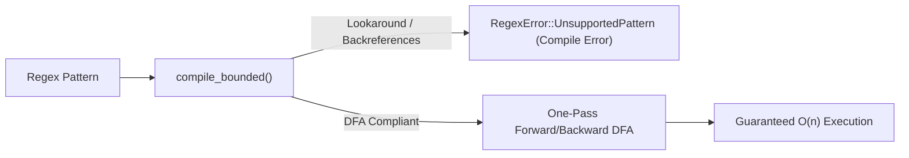

# Data Formats, Schemas & Bounded Regex

Lust provides a high-performance, memory-safe data processing and schema validation subsystem designed for zero-overhead parsing, strict semantic guarantees, and bounded resource execution.

Rather than relying on loosely typed dynamic dictionaries or heavyweight external libraries, Lust introduces first-class data models and schemas built on the **Small Core, Rich Stdlib** philosophy: all formats, validators, and regex engines are provided via standard library modules (`@std/data`, `@std/schema`, `@std/regex`) and native runtime primitives.

---

## Architecture and Core Invariants

The data subsystem operates on four foundational architectural principles:

1. **Semantic Safety & Fail-Closed Validation (Gate-SCHEMA-01):**
   - Parsers strictly reject malformed or ambiguous data. Duplicate object keys in JSON and YAML, duplicate columns in TOON, and duplicate fields in `Document` are immediately rejected with errors.
   - Non-finite numbers (`NaN`, `Infinity`, `1e999`) and integers exceeding 64-bit lanes fail closed during parsing rather than being silently truncated or converted to lossy `f64`.
2. **Strict Memory & Hostile Input Bounding (Gate-SCHEMA-02 & Gate-SCHEMA-06):**
   - Resource budgets (`BudgetTracker`) constrain memory allocation and parsing depth.
   - YAML parsers reject recursive alias bombs (Billion-Laughs attacks) by enforcing a strict $10\times$ expansion limit: $B_{\text{exp}} \le 10 \cdot \max(1, B_0)$.
   - Streaming JSONL readers enforce hard line and buffer limits, preventing memory exhaustion on unbounded inputs.
3. **Guaranteed Linear-Time Regex (Gate-SCHEMA-08):**
   - Regular expressions run on a one-pass Deterministic Finite Automaton (DFA) engine with guaranteed $O(n)$ linear execution time, providing complete immunity to Regular Expression Denial of Service (ReDoS).
   - Non-linear patterns (such as backreferences or lookaround assertions) are strictly rejected at compile time.
4. **Direct Ordinal Materialization (Gate-SCHEMA-09):**
   - Validated data materializes into struct layouts using fixed numerical ordinals (`field.ordinal` from $0$ to $N-1$) without runtime hash table lookups.

---

## Supported Data Formats

Lust standardizes data exchange across five primary formats:

| Format | Module | Primary Use Case | Key Safety Properties |
|---|---|---|---|
| **JSON** | `@std/data/json` | Web APIs, configuration | Strict RFC 8259, rejects duplicate keys, exact number parsing |
| **JSONL** | `@std/data/jsonl` | Streaming logs, big data | Memory-bounded streaming reader, chunked processing, cancellation tokens |
| **JSONC** | `@std/data/jsonc` | Human-editable configs | Preserves JSON comments (`//`, `/* */`), trailing comma support |
| **BSON** | `@std/data/bson` | Binary storage, RPC | Preserves `ObjectId`, `DateTimeUtc`, `Decimal128`, and unsigned 64-bit ints |
| **YAML** | `@std/data/yaml` | Declarative definitions | Safe YAML 1.2 subset, Billion-Laughs alias expansion limits |
| **TOON** | `@std/data/toon` | Tabular data | Column-oriented encoding, duplicate column rejection |

### 1. JSON Parsing & Serialization

The JSON module strictly enforces RFC 8259 compliance. Duplicate keys, trailing commas, unquoted control characters, and non-finite floats are strictly forbidden:

> 📂 **Runnable example:** [`examples/schemas/02_json_deserialization.rs`](https://github.com/ArchangelJTW/lust-lang/blob/master/examples/schemas/02_json_deserialization.rs)\
> 💻 *Compiler repository file:* `examples/schemas/02_json_deserialization.rs`

```lust
use std.data.json
use std.data.Document

-- Encoding data to JSON string
local payload: Map<string, unknown> = {
    user_id = 1042,
    username = "alex",
    is_active = true
}
local json_str: string = json.encode(payload)
println(json_str)

-- Decoding JSON string into a structured Document
local parsed = json.decode(json_str)?
println("User ID: " .. tostring(parsed["user_id"]))
```

```rust
// In Rust host / embedding:
use lust::data::json::{self, JsonError};

// Gate-SCHEMA-01: Duplicate keys are rejected
let res = json::from_str(r#"{"key": 1, "key": 2}"#);
assert!(matches!(res, Err(JsonError::DuplicateKey(_))));

// Large integers (> 2^53 - 1) maintain exact representation without narrowing
let big_num = json::from_str(r#"{"id": 9007199254740993}"#).unwrap();
```

### 2. Memory-Bounded Streaming JSONL

When processing massive datasets, gigabyte-sized log dumps, or real-time event feeds, buffering the entire payload into memory causes out-of-memory panics. Lust's streaming JSONL reader processes inputs line-by-line within bounded memory:

```lust
use std.data.jsonl
use std.io

-- Stream lines with a fixed 32KB buffer limit
local reader = jsonl.open_reader("events.jsonl", {
    max_line_bytes = 16384,
    buffer_capacity = 32768
})?

for record in reader do
    -- Each record is decoded and validated without accumulating previous lines
    if record["level"] == "ERROR" then
        println("Found error event: " .. record["message"])
    end
end
```

Key guarantees of the JSONL streaming engine:
- **$O(1)$ Memory Footprint:** Buffers are recycled between lines.
- **Hostile Line Protection:** Lines exceeding `max_line_bytes` immediately fail closed with `LineErrorKind::LineTooLong` without allocating up to the end-of-line marker.
- **Cancellation Tokens:** Background workers can halt stream decoding cooperatively via `CancellationToken`.

### 3. Binary JSON (BSON)

BSON preserves native binary types without textual conversion overhead:

> 📂 **Runnable example:** [`examples/schemas/03_messagepack_binary.rs`](https://github.com/ArchangelJTW/lust-lang/blob/master/examples/schemas/03_messagepack_binary.rs)\
> 💻 *Compiler repository file:* `examples/schemas/03_messagepack_binary.rs`

```rust
use lust::data::{bson, DataValue, Document, ExactNumber};

let mut doc = Document::new();
doc.try_insert("id", DataValue::Number(ExactNumber::UInt(u64::MAX))).unwrap();
doc.try_insert("created_at", DataValue::DateTimeUtc(1700000000000)).unwrap();

// Serialize to BSON bytes
let bson_bytes: Vec<u8> = bson::to_vec(&doc);

// Zero-copy / bounded document view
let decoded_doc = bson::from_slice(&bson_bytes).unwrap();
assert_eq!(decoded_doc.get("id").unwrap(), &DataValue::Number(ExactNumber::UInt(u64::MAX)));
```

BSON views inspect child boundaries: nested documents declaring lengths exceeding their parent slice are rejected immediately.

### 4. Safe YAML (LustSafeYaml12)

Lust YAML parsing prevents common security vulnerabilities:
- **Billion-Laughs Defense:** Recursive alias references (e.g. `*alias`) are tracked; if cumulative expanded nodes exceed $10\times$ the source document size, parsing terminates with `YamlError::AliasBudgetExceeded`.
- **No Implicit Object Instantiation:** Custom YAML tags cannot execute code or instantiate arbitrary host types.
- **Fail-Closed Duplicate Keys:** Repeating a mapping key within the same dictionary raises `YamlError::DuplicateKey`.

---

## Schema Definition & Validation (`@std/schema`)

Lust provides a composable, fluent schema builder API rooted at the `s` factory. Schemas allow you to validate types, check numeric ranges, enforce string constraints, and transform data safely.

### The `s` Builder API

> 📂 **Runnable example:** [`examples/schemas/01_schema_validation.rs`](https://github.com/ArchangelJTW/lust-lang/blob/master/examples/schemas/01_schema_validation.rs)\
> 💻 *Compiler repository file:* `examples/schemas/01_schema_validation.rs`

```rust
use lust::schema::s;
use lust::data::{DataValue, Document, ExactNumber};

// Construct a user profile schema
let user_schema = s.object()
    .field("id", s.int().min(1).max(1_000_000).build())
    .field("username", s.string().min(3).max(32).build())
    .field("email", s.string().regex(r"^[a-zA-Z0-9._%+-]+@[a-zA-Z0-9.-]+\.[a-zA-Z]{2,}$").build())
    .field("age", s.int().min(0).max(150).build().optional())
    .field("bio", s.string().max(500).build().optional().nullable())
    .strict() // Rejects any extra, unregistered fields
    .build();
```

### Core Schema Types

| Schema Builder | Validation Checks |
|---|---|
| `s.string()` | `.min(len)`, `.max(len)`, `.regex(pattern)`, `.exact(len)` |
| `s.int()` | `.min(val)`, `.max(val)`, integer lane enforcement |
| `s.float()` | `.min(val)`, `.max(val)`, strict `NaN` rejection |
| `s.bool()` | Strict boolean check (`true` / `false`) |
| `s.binary()` | `.min(bytes)`, `.max(bytes)` |
| `s.array(item_schema)` | `.min(count)`, `.max(count)`, per-element validation |
| `s.object()` | Named fields, `.strict()` mode for extra field rejection |
| `s.record(key, val)` | Dynamic dictionary with typed keys and values |
| `s.union(variants)` | Value must match one of the candidate schemas |
| `s.discriminated_union(tag, variants)` | Fast dispatch on a discriminator tag field |
| `s.literal(value)` | Exact value comparison |

### Required, Optional, and Nullable Fields

Fields are **required** by default. Use explicit modifier methods to adjust field optionality:

- `.optional()`: The field may be completely omitted from the object. If present, it must conform to the inner schema.
- `.nullable()`: The field value may be `null` (`DataValue::Null`).
- `.optional().nullable()`: The field may either be missing, `null`, or a valid value. Missing fields in this configuration do not fail validation.

### Range Checks & NaN Immunity

In standard IEEE 754 floating-point arithmetic, comparisons involving `NaN` evaluate to `false` (e.g. `NaN >= min` is `false`, `NaN <= max` is `false`). Poorly designed validators might accidentally admit `NaN` if checks are written using inverted logic.

Lust enforces **strict NaN rejection**:

```rust
let schema = s.float().min(0.0).max(100.0).build();

// Valid numbers pass
assert!(schema.parse(&DataValue::Number(ExactNumber::Float(42.5))).is_ok());

// NaN is explicitly rejected, never bypassing bounds
let nan_val = DataValue::Number(ExactNumber::Float(f64::NAN));
assert!(schema.parse(&nan_val).is_err());
```

### Custom Refinements & Transformations

You can extend built-in validators with custom pure functions:

```rust
// Refine with custom predicate and error message
let even_schema = s.int()
    .build()
    .refine_with_message(|val| {
        if let DataValue::Number(ExactNumber::Int(n)) = val {
            n % 2 == 0
        } else {
            false
        }
    }, "Number must be even");

// Transform data during validation
let trimmed_string = s.string()
    .build()
    .transform(|val| {
        if let DataValue::String(s) = val {
            DataValue::String(s.trim().to_string())
        } else {
            val
        }
    });
```

### Typed Materialization into Structs

Validated data can be materialized directly into memory-compact struct representations:

```rust
use lust::data::layout::{LogicalLayoutV1, LogicalFieldDesc, CanonicalTypeTag, TargetAbi};
use lust::data::materialize::materialize_from_document;

let layout = LogicalLayoutV1::new_with_abi(
    1001,
    "UserProfile",
    vec![
        LogicalFieldDesc::new(0, "id", CanonicalTypeTag::Int64),
        LogicalFieldDesc::new(1, "active", CanonicalTypeTag::Bool),
    ],
    TargetAbi::x86_64(),
);

let mut doc = Document::new();
doc.try_insert("id".to_string(), DataValue::Number(ExactNumber::Int(42))).unwrap();
doc.try_insert("active".to_string(), DataValue::Bool(true)).unwrap();

let materialized = materialize_from_document(&layout, &doc).unwrap();
assert_eq!(materialized.get_slot(0), Some(&DataValue::Number(ExactNumber::Int(42))));
```

Materialization guarantees:
- **Missing Required Fields:** Returns `MaterializeError::MissingField` immediately.
- **Extra Fields in Strict Layouts:** Returns `MaterializeError::ExtraFieldInStrictLayout`.
- **Target ABI Awareness:** Field alignment and pointer widths adapt to the target architecture (x86_64, aarch64, or 32-bit targets like rv32).

### `ContiguousStruct`, C11 Layout Parity & Zero-DOM AOT Decoders (`lust::w17_layout`)

For high-throughput binary and JSON ingestion without intermediate DOM trees or hash-map allocations, Lust builds directly on **`LogicalLayoutV1`** and **`ContiguousStruct`** (`src/data/materialize.rs`, verified by **`Gate-SCHEMA-09`** and **`Gate-SCHEMA-13`** in **`lust::w17_layout`**):

- **Contiguous Memory Layout (`ContiguousStruct`):** Stores fields in an `AlignedStorage` byte buffer matching the target ABI's C11 struct offsets and alignment, with bitmask tracking for initialized and null slots (`is_initialized`, `is_null`, `cleanup_partial`) and typed unaligned-safe accessors (`read_i64_at`, `read_u64_at`, `read_f64_at`, `read_bool_at`, `read_str_at`, `read_bytes_at`, `read_nested_at`).
- **Direct JSON Decoding (`decode_json_into_contiguous`, `decode_json_with_plan`):** Parses JSON bytes straight into a `ContiguousStruct` using a precomputed `StructBindingPlan` and `WireAliasMap`, paired with `ModelContract` record-level validation and `FfiBoundaryRuntime` watchdog containment (`lust::w17_layout`).
- **C11 Layout Parity Verification (`lust::w17_layout::c_abi`):** Compares `LogicalLayoutV1` byte sizes and field offsets against real C11 `clang`/`cc` sanitizer fixtures (`compare_layout_with_c_entry`, `build_c_fixture_with_sanitizers`) and Zig layout probes (`verify_zig_layout_probe`).
- **Native Cranelift JIT & CL-AOT Struct Decoding (`__mir_struct_decode_into:*`):** Both Cranelift JIT and `--backend cranelift-aot` lower struct decoding natively with `SEC-02` memory budget enforcement (delivering `4.46×` CL-AOT and `2.01×` Cranelift JIT speedups on `BENCH-NG-13`).
- **`#![no_std] + alloc` Core Data & Schema Modules:** The core `data` (JSON, JSONC, JSONL, CSV/TSV, YAML, TOON, BSON, MessagePack), `schema`, and `model` modules compile cleanly in `lust-rs` `rlib` under `--no-default-features` on both host and ARM Cortex-M (`thumbv7em-none-eabihf`), while host-only streaming I/O (`data::chunked_stream`) and DFA regex helpers remain gated under `std`.
- **Rust AOT `#[repr(C)]` Zero-DOM Decoders:** When compiling schemas with `lust build --backend rust`, emitted structs carry `#[repr(C)]` layouts and generate two direct decoders backed by `lust-aot-rt`:
  - `decode_binary(raw: &[u8], ctx: &mut lust_aot_rt::AotCtx)` / `decode_binary_at(raw, base_offset, ctx)` — Zero-lookup, unaligned-safe binary materialization directly from byte slices.
  - `decode_json(s: &str, ctx: &mut lust_aot_rt::AotCtx)` / `decode_json_cursor(cur: &mut lust_aot_rt::schema::JsonCursor<'_>, ctx)` — Single-pass, zero-DOM, zero-hash-lookup JSON decoding directly into the `#[repr(C)]` struct.

### Borrowed Script Views & Zero-Allocation Scalar Reads

Scripts can inspect and update structured data in place without cloning containers via borrowed views (`&T`, `&mut T`) and the `view` namespace:

```lust
struct FixedBox
    value: int
    label: string
end

function read_box_ref(b: &FixedBox): int
    return view.read(b.value)
end

function bump_box_mut(b: &mut FixedBox): int
    b.value = view.read(b.value) + 1
    return view.read(b.value)
end

function main(): int
    local box = FixedBox { value = 10, label = "sensor" }
    local current = 0
    local snapshot = FixedBox { value = 0, label = "" }

    -- Lexical scope ends the shared borrow before taking `&mut box`:
    if true then
        local r: &FixedBox = view.borrow(box)
        current = read_box_ref(r)
        -- Deeply clone into an independent owned value when escaping a view scope:
        snapshot = view.materialize(r)
    end
    return current + bump_box_mut(&mut box) + snapshot.value
end
```

Standalone `lust` CLI execution automatically wires the `view` extern declarations and runtime bridge at startup, giving CLI runs full stdout, exit-code, and `E4G001`–`E4G006` diagnostic parity with `LifetimeVm::compile_script(...)` on both the Bytecode VM and Cranelift JIT. On the Rust embedding side, use `LifetimeVm::compile_script(...)` (or an `EmbeddedProgram` configured with `declare_view_externs` and `install_view_runtime`) to inspect script structs via generation-checked handles: `GenStructHandle::prepare_scalar_field("field")` produces a **`PreparedScalarHandle`** (`lust::w17_lifetime`) that resolves field metadata once and performs **zero-allocation scalar reads** (`prepared.read_i64()?`) while still validating VM generation and owner liveness on every access. See [Borrowed Views & Lifetime / Generation Safety](./embedding.md#borrowed-views--lifetime--generation-safety-lustw17_lifetime).

---

## Bounded Regex (`@std/regex`)

Regular expressions in web servers, microservices, and user-facing scripts are a common vector for denial-of-service attacks. When an engine uses backtracking or NFA simulation with exponential states, crafted input can cause the CPU to spike to 100% indefinitely (ReDoS).

Lust completely eliminates this attack surface with **BoundedRegex**:



### Deterministic $O(n)$ Linear-Time Execution

`BoundedRegex` uses a one-pass DFA compiled via `regex-automata`. Every character of input is processed in constant time $O(1)$, guaranteeing that an $n$-byte input takes strictly $O(n)$ time regardless of pattern complexity:

```rust
use lust::regex::BoundedRegex;

let re = BoundedRegex::new(r"^[a-zA-Z0-9._%+-]+@[a-zA-Z0-9.-]+\.[a-zA-Z]{2,}$").unwrap();

assert!(re.is_match("dev@lust-lang.org").unwrap());
assert!(!re.is_match("invalid-email").unwrap());
```

### Complete ReDoS Prevention: Fail-Closed Policy

Any regex feature that would require backtracking or non-linear state exploration is **strictly rejected at compile time**:

```rust
use lust::regex::{compile_bounded, RegexError};

// 1. Lookahead assertions (?=...) are rejected
let lookahead = compile_bounded(r"(?=abc)abc");
assert!(matches!(lookahead, Err(RegexError::UnsupportedPattern(_))));

// 2. Lookbehind assertions (?<=...) are rejected
let lookbehind = compile_bounded(r"(?<=user_)profile");
assert!(matches!(lookbehind, Err(RegexError::UnsupportedPattern(_))));

// 3. Backreferences (\1) are rejected
let backref = compile_bounded(r"([a-z])\1");
assert!(matches!(backref, Err(RegexError::UnsupportedPattern(_))));
```

Lust has **zero fallback to an NFA or backtracking engine**. If a pattern cannot be compiled into a bounded DFA, it is treated as a compile error.

### Pattern Size & Work Budgeting

To guard against resource exhaustion at regex compilation time:
- Patterns larger than the configured size ceiling (e.g. 64KB) fail with `RegexError::PatternTooLarge`.
- `RegexWorkTracker` monitors total DFA state transitions, scaling strictly linearly with input length.

### Search, Match, and Replace API

```rust
use lust::regex::BoundedRegex;

let re = BoundedRegex::new(r"[0-9]+").unwrap();

// Find single match with offsets
if let Some(m) = re.find("Batch size: 250 items").unwrap() {
    assert_eq!(m.text, "250");
    assert_eq!(m.start, 12);
    assert_eq!(m.end, 15);
}

// Find with performance diagnostics
let (matched, stats) = re.find_with_stats("ID: 1042").unwrap();
assert!(matched.is_some());
assert_eq!(stats.dfa_searches, 2); // Bidirectional search (forward + reverse DFA)

// Text replacement
let sanitized = re.replace("order 42 in queue 7", "###").unwrap();
assert_eq!(sanitized, "order ### in queue 7");
```

---

## Practical Example: Validated Pipeline with `|>`

Combining data parsing, schema validation, and pipeline operators:

> 📂 **Runnable example:** [`examples/schemas/04_schema_dsl.lust`](https://github.com/ArchangelJTW/lust-lang/blob/master/examples/schemas/04_schema_dsl.lust)\
> 💻 *Compiler repository file:* `examples/schemas/04_schema_dsl.lust`

```lust
use std.data.json
use std.schema.s
use std.regex.BoundedRegex

-- 1. Define schema
local UserSchema = s.object()
    .field("id", s.int().min(1).build())
    .field("email", s.string().regex("^[a-z]+@[a-z]+\\.[a-z]+$").build())
    .field("role", s.string().min(1).build())
    .build()

-- 2. Processing function with validation pipeline
function process_user_registration(raw_json: string): Result<string, string>
    local user = raw_json
        |> json.decode()?
        |> UserSchema.validate()?

    return Result.Ok("Registered user " .. user["email"])
end

local input = '{"id": 42, "email": "admin@lust.dev", "role": "maintainer"}'
local result = process_user_registration(input)
println(result:unwrap()) -- "Registered user admin@lust.dev"
```
