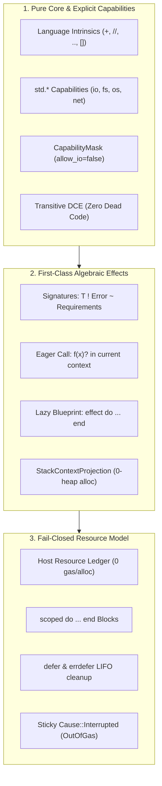

# Pure Core & Effects Architecture in Lust

Lust features a **Pure Core & Typed Algebraic Effects** system providing static tracking of side effects, zero-allocation dependency injection, algebraic effect handlers (`handle ... with` and `resume(val)`), capability-based security boundaries, and predictable resource finalization across the Bytecode VM, Cranelift JIT/AOT, `#![no_std]` Rust AOT (`lust-aot-rt`), and Zig AOT engines.

---

## 1. Architectural Philosophy: Pure Core & Algebraic Effects

Modern software architectures frequently face critical maintenance and security challenges:
- **Hidden Side Effects:** Pure business logic functions perform hidden database mutations, disk reads, or network telemetry.
- **Ambient Authority:** Any imported script or third-party package can silently access files, sockets, or environment variables.
- **Leaked Resources & Cancellation Bugs:** When an async operation aborts (due to timeout or gas limits), open file descriptors and sockets are leaked.
- **Runtime DI Overhead:** Dependency injection frameworks introduce dynamic reflection, heap allocations, and virtual call dispatch penalties.

Lust resolves these challenges through three core design pillars:



### 1.1 Pure Core vs. Ambient Authority

In Lust, a sandboxed or library module runs by default in **`PreludeMode::Pure`**:
- **Language Intrinsics:** String concatenation (`..`), indexing (`arr[i]`), slice access, and math operations (`+`, `-`, `//`, `^`) are built-in language primitives. They utilize the current context's memory arena and require no external library permissions.
- **Zero Ambient Authority:** There are no implicit globals for disk, network, or terminal I/O. Accessing external resources requires an explicit import (`use std.io;`, `use std.os;`) and must be declared in the function's effect signature.
- **Transitive Dead-Code Elimination (DCE):** Unused capabilities and runtime helpers are eliminated during compilation. If a pure script uses only string and math operations, the compiler generates no symbols for `libc`, POSIX sockets, or file systems.

### 1.2 Eager Execution vs. Lazy Blueprints

Lust clearly separates immediate effect execution from lazy program descriptions:

1. **Eager Effect Calls (`f(x)?`):**
   Calling an effectful function executes immediately in the caller's context with zero wrapper overhead. The `?` operator unrolls success values or propagates errors directly.
2. **Lazy Blueprints (`effect do ... end`):**
   An `effect do ... end` block freezes execution into a first-class `Effect<A, E, R>` blueprint. Constructing a blueprint performs **zero side effects**.
3. **Replayability Contract:**
   Running a blueprint multiple times (e.g. via `blueprint:run_sync()`) executes the body afresh on each invocation, ensuring clean, isolated state per run.

---

## 2. Effect Declarations & Signatures

In Lust, effect declarations and function signatures make errors and required services visible to the typechecker.

### 2.1 Function Effect Signatures

A function's return specification (`ReturnSpec`) can specify:
- Return type (`T`)
- Typed error branch preceded by `!` (`! ErrorType`)
- Contextual service requirements preceded by `~` (`~ RequirementRow`)

> 📂 **Runnable example:** [`examples/effects/04_effects_syntax.lust`](https://github.com/ArchangelJTW/lust-lang/blob/master/examples/effects/04_effects_syntax.lust)\
> 💻 *Compiler repository file:* `examples/effects/04_effects_syntax.lust`

```lust
-- Declares a function returning string, potentially failing with HttpError,
-- and requiring both 'Network' and 'Console' capabilities.
function fetch_data(url: string): string ! HttpError ~ (Network + Console)
    local console = service<Console>()
    console.log("Fetching: " .. url)

    local net = service<Network>()
    return net.get(url)?
end
```

If a function does not fail, the `! Error` clause is omitted. If it requires no ambient capabilities, the `~ Requirements` clause is omitted.

### 2.2 Nominal Service Declarations

Services are declared nominally to guarantee distinction, even when their underlying methods or structures are identical:

```lust
struct Database
    url: string
end

-- Nominal services: PrimaryDb and ReplicaDb are distinct types
service PrimaryDb: Database
service ReplicaDb: Database

-- The requirement PrimaryDb + ReplicaDb maintains two distinct slots!
function sync_tables(): bool ! DbError ~ (PrimaryDb + ReplicaDb)
    local master = service<PrimaryDb>()
    local replica = service<ReplicaDb>()
    -- synchronize master and replica
    return true
end
```

### 2.3 Row Polymorphism & Set Equality

Service requirement rows exhibit **unordered set equality** (Row Polymorphism):

$$\text{Effect}\langle T, E, A + B \rangle \equiv \text{Effect}\langle T, E, B + A \rangle$$

The typechecker normalizes and deduplicates requirement rows. When functions call one another in a recursive group (SCC &mdash; Strongly Connected Component), the compiler computes the fixed-point union of all transitive requirements:

$$R(v) = R_{\text{local}}(v) \cup \bigcup_{(v, u) \in \text{Edges}} R(u)$$

If a caller fails to declare a capability required by any transitive callee, the compiler reports a compile-time error:
```text
CompileError: Unsatisfied requirement: 'FileSystem' in call to 'read_config'
```

---

## 3. Handlers and Context Provision

Requirements declared in `~ (Req1 + Req2)` represent unsatisfied effect dependencies. Before an effect blueprint is executed, those requirements must be handled or provided.

### 3.1 Algebraic Effect Handlers (`handle { ... } with { ... }` & `resume(val)`)

Lust supports algebraic effect handlers in both the Bytecode VM (`Compiler::compile_module` / `VM::call`) and the Rust AOT (`AotCompiler::compile_source_rust` / `lust-aot-rt`) compiler. Code inside a `handle { ... } with { ... }` expression performs operations via `perform("OpName", [args...])`, and matching handler arms resume the delimited continuation with `resume(val)`:

> [!NOTE]
> **CLI TypeChecker note:** Full type inference for untyped handler arm parameters (such as `Step(x)` and `AskInt(v)` below) is still pending in `TypeChecker`. These handlers currently execute via the lower-level VM/AOT compiler APIs (`Compiler::compile_module` / `AotCompiler::compile_source_rust`, as exercised in `tests/ng_w17_handlers.rs`, `tests/ng_w13_1a_aot_services_tail_handlers.rs`, and `tests/ng_w13_1b_aot_async_nontail_handlers.rs`); invoking `lust run` on untyped arm arithmetic currently reports an unresolved parameter type `_`.

```lust,ignore
-- Tail-resumptive handler: resumes directly in tail position
function run_tail_handler(): int
    return handle {
        let a: int = perform("Step", [4]);
        let b: int = perform("Step", [6]);
        a + b
    } with {
        Step(x) => resume(x * 10)
    }
end

-- One-shot non-tail handler: executes work both before AND after resume(val)
function run_nontail_handler(): int
    return handle {
        println("body_pre");
        let x: int = perform("AskInt", [10]);
        println("body_post:" .. tostring(x));
        x * 2
    } with {
        AskInt(v) => {
            println("handler_pre:" .. tostring(v));
            let r: int = resume(v + 5);
            println("handler_post:" .. tostring(r));
            r + 100
        }
    }
end
```

Handler execution semantics across engines:
- **Tail-Resumptive Fast Path (`lust_aot_rt::handle_tail_resumptive_typed`):** When every arm invokes `resume(...)` in tail position (or aborts without resuming), the handler executes directly on the stack with zero continuation heap allocation.
- **One-Shot Non-Tail Continuations (`lust_aot_rt::handle_non_tail_oneshot`):** When a handler arm performs work after `resume(val)` (capturing the body's result `r` and transforming it), the Bytecode VM suspends/resumes frames while the Rust AOT compiler lowers the handled body into a **CPS state machine** (`src/aot/compiler.rs`), including `while` loops containing handled `perform` calls (lowered to recursive `__cps_loop_step_*` step functions) and helper callees. Multi-shot `resume` is statically rejected to preserve deterministic resource cleanup.
- **Nested & Shadowing Handlers:** Inner `handle` blocks shadow outer arms for the same operation while transparently forwarding unhandled operations to enclosing handlers.

### 3.2 Zero-Heap Context Projection (`StackContextProjection`)

When function `f` (with requirements `Env_ABC = A + B + C`) calls function `g` (requiring only `Env_AC = A + C`), naive systems allocate a hash map or heap-based dictionary adapter.

In Lust, this is solved with **`StackContextProjection<N>`**:
1. The caller allocates a tiny projection descriptor directly on its **native call stack frame** (copying two 64-bit service pointers).
2. The callee receives a pointer to the stack-allocated adapter.
3. Upon return, the stack pointer (`SP`) is restored.
4. **Result:** Exactly **0 heap allocations** and sub-nanosecond adapter overhead (~0.34 ns in release builds).

```rust
// Rust Runtime Type in src/effect_abi.rs
#[repr(C)]
pub struct StackContextProjection<const N: usize> {
    pub service_ptrs: [*const core::ffi::c_void; N],
    pub service_tags: [u32; N],
}
```

---

## 4. Security & Capability-Based Authority Model

Lust's effect model provides unbreakable sandboxing for untrusted scripts.

### 4.1 Host `CapabilityMask`

When embedding Lust in a host application (Rust or C), the host configures a `CapabilityMask`:

```rust
use lust::config::{CapabilityMask, LustConfig};
use lust::EmbeddedProgram;

let mut config = LustConfig::default();

// Deny all ambient capabilities by default
config.set_capability_mask(CapabilityMask::none());

// Explicitly opt-in to specific modules
config.allow_std_module("json");
config.allow_std_module("regex");
// config.allow_std_module("io"); // IO remains disallowed!
```

| Capability | Flag | Controls |
| :--- | :--- | :--- |
| **I/O** | `allow_io` | Console printing, terminal interaction |
| **File System** | `allow_fs` | File and directory read/write |
| **OS / Clock** | `allow_os` | System clocks, environment variables, process control |
| **Networking**| `allow_net` | Sockets, HTTP, DNS resolution |
| **Concurrency**| `allow_task` | Spawning background tasks and worker threads |

### 4.2 Compile-Time Opt-In Denial

If a script attempts to import a module forbidden by the host's capability mask (`import io from "@std/io";` or `use std.io;`), the compilation fails immediately:

```text
LustError::CompileError: Access denied: module 'std.io' is not permitted by host capability mask
```

This denial occurs at **compile time**, before any bytecode or native machine code is generated or executed.

### 4.3 Compilation Cache Key Isolation

To prevent capability leaks through bytecode caching, the compilation cache key (`CompilationCacheKey`) incorporates:
- Module source hash
- `prelude_mode` (`Pure` vs `Standard`)
- Full `capability_mask` bitflags
- Standard library catalog version

A module compiled in permissive mode can **never** be served to a sandboxed caller.

---

## 5. Performance: Inlining & Native Parity

Lust eliminates the traditional performance penalties of effect systems through specialized MIR and bytecode lowering optimizations.

### 5.1 Inlining of Effect Thunks (`run_sync`)

When an effect block is constructed and executed synchronously:

> 📂 **Runnable example:** [`examples/effects/01_basic_effects.rs`](https://github.com/ArchangelJTW/lust-lang/blob/master/examples/effects/01_basic_effects.rs)\
> 💻 *Compiler repository file:* `examples/effects/01_basic_effects.rs`

```lust
local program = effect do
    return 10 * 4 + 2
end
local result = program:run_sync()
```

The Lust compiler performs compile-time thunk devirtualization and inlining:
1. **In Bytecode:** The bytecode compiler emits the body instructions inline, directing return statements to a dedicated continuation register.
2. **In MIR & Cranelift:** The MIR lowering pipeline (`lower_effect_run_sync`) replaces the thunk reference with an inlined control-flow block, targeting a `continuation_bb`.
3. **Zero Function Calls:** In the generated machine code, `run_sync` dissolves into direct arithmetic instructions.

### 5.2 Read-Only Snapshot Integer Captures

Effect blocks can capture variables from their outer scope. To avoid closure heap allocations and pointer indirection, Lust enforces **Snapshot Integer Captures**:
- Free integer variables used inside `effect do ... end` are captured by **copying a snapshot** to a local temporary (`__thunk_cap_<name>_<var>`).
- If an effect attempts to capture mutable or escaping pointers, the compiler rejects it with:
  `Unsupported capture type: only read-only integers are supported`.
- As a result, constructing an effect block requires **0 heap allocations** and operates purely on registers and the stack.

### 5.3 Parity Across VM, Cranelift JIT/AOT, Rust AOT, and Zig AOT

Lust guarantees semantic parity across all execution targets, including Cranelift JIT deoptimization handoff back to the interpreter via **`VM::resume_from_deopt`** (which reconstructs the target call frame and live registers from `take_deopt_payload()`, including validated empty-stack root-frame entry when deoptimizing directly from a top-level JIT entry):

| Runtime Profile | Effect & Handler Support | Memory Allocation | Interruption Propagation |
| :--- | :--- | :--- | :--- |
| **Bytecode VM** | Full (`handle ... with`, tail & one-shot non-tail `resume`) | 0 bytes heap (tail path) | Deterministic instruction counter & `resume_from_deopt` |
| **Cranelift JIT / Object AOT** | Pure core, services, OSR & lazy deopt to VM | 0 bytes heap | Hardware safepoint polling & validated `resume_from_deopt` |
| **Rust AOT (`lust-aot-rt`)** | Full (tail fast path + CPS state machine for non-tail, loops & callees, `AotScope`) | Zero-dep `#![no_std]`, `LustBudgetAlloc` | `Result<_, AotError>` + `core::mem::DropGuard` LIFO cleanup (even under `panic=abort`) |
| **Zig AOT** | Pure core, services, `StackContextProjection` | 0 bytes heap | Direct C-ABI register pass |

---

## 6. Common Patterns & Best Practices

### 6.1 Structured Resource Cleanup (`scoped`, `defer`, `errdefer`)

Lust combines effect scopes with deterministic RAII-style cleanup:

> 📂 **Runnable example:** [`examples/effects/03_acquire_release_and_scopes.rs`](https://github.com/ArchangelJTW/lust-lang/blob/master/examples/effects/03_acquire_release_and_scopes.rs)\
> 💻 *Compiler repository file:* `examples/effects/03_acquire_release_and_scopes.rs`

```lust
function process_transaction(db_url: string, payload: string): bool ! DbError ~ (Database + Logger)
    scoped do
        local conn = open_connection(db_url)?
        defer close_connection(conn)                -- Always executes on scope exit
        errdefer log_error("Transaction failed!")   -- Executes ONLY on error or interrupt

        local tx = conn.begin_tx()?
        defer tx.rollback_if_active()

        tx.write(payload)?
        tx.commit()?
        return true
    end
end
```

- `scoped do ... end`: Defines an explicit lifecycle boundary. All resources are cleaned up before the block returns.
- `defer`: Guaranteed **LIFO** (Last-In, First-Out) execution.
- `errdefer`: Dormant during normal completion; activated automatically if an error or terminal interrupt occurs.

### 6.2 Fail-Closed Interruption Algebra

Every effect terminates in an `Exit<A, E>`:

> 📂 **Runnable example:** [`examples/effects/02_retry_and_repeat.rs`](https://github.com/ArchangelJTW/lust-lang/blob/master/examples/effects/02_retry_and_repeat.rs)\
> 💻 *Compiler repository file:* `examples/effects/02_retry_and_repeat.rs`

```rust
pub enum Exit<A, E = String> {
    Success(A),
    Failure(Cause<E>),
}

pub enum Cause<E> {
    Fail(E),                        // Recoverable, typed application error
    Die(String),                    // Unchecked defect / panic
    Interrupted(InterruptReason),   // Sticky terminal interruption (Cancelled, OutOfGas, Timeout)
}
```

#### Sticky Interruption Invariant
Unlike typed errors (`Cause::Fail`), terminal interrupts (`Cause::Interrupted`) **cannot** be swallowed, caught with `.catch()`, or suppressed by `retry`. They propagate directly to the root supervisor, ensuring that timeouts, gas depletion, and fiber cancellations terminate execution reliably.

### 6.3 Mocking Capabilities in Tests (`@std/test`)

The standard testing framework (`@std/test`) allows seamless mocking of service capabilities:

> 📂 **Runnable example:** [`examples/effects/05_dependency_injection_mocking.rs`](https://github.com/ArchangelJTW/lust-lang/blob/master/examples/effects/05_dependency_injection_mocking.rs)\
> 💻 *Compiler repository file:* `examples/effects/05_dependency_injection_mocking.rs`

```lust,ignore
-- Service-injection mocking pattern with @std/test
use @std/test.{suite, test, assert_eq, assert_success}

struct MockDb
    items: Array<string>
end

service Database: MockDb

suite "User Repository Tests" do
    test "loads user from mocked store" do
        local mock = MockDb { items = ["User1", "User2"] }

        -- Run effect with mock database
        local result = handle load_user(0) with Database = mock
        assert_success(result, "User1")
    end
end
```

---

## Runnable Supervision & Structured Concurrency Example (`06_concurrency_and_supervision`)

- `examples/effects/06_concurrency_and_supervision.lust` — runnable `suite`/`test` example exercising structured scopes (`test.scope_new`, `test.scope_begin_teardown`), interrupt masking (`test.fiber_enter_mask` / `test.fiber_exit_mask`), `Gate-NEG-02` joining invariant, and LIFO finalizer teardown (`lust test examples/effects/06_concurrency_and_supervision.lust`). See [Simulation Testing (DST)](./simulation-testing.md).
