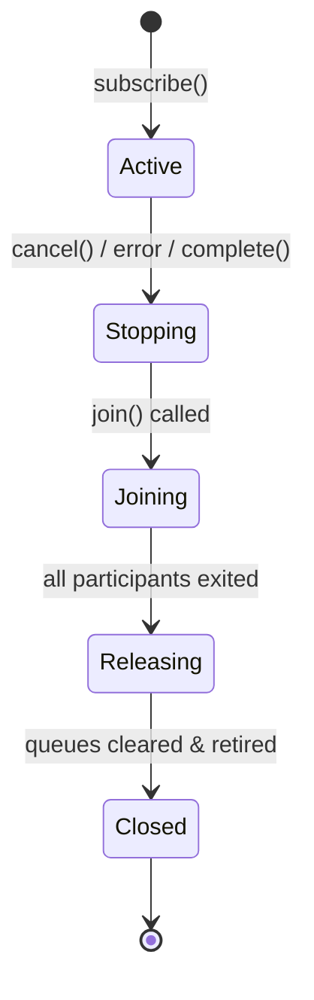
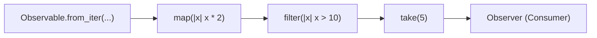

# Reactive Programming (Rx & Observables) in Lust

> [!NOTE]
> **Design Specification / RFC:** This chapter describes the architectural specification for reactive programming and Observables in Lust.

Lust provides a first-class Reactive Streams (Rx) subsystem designed for high-performance, asynchronous event streams, deterministic simulation, and real-time data processing.

The reactive engine combines the declarative power of reactive programming (Observables, Observers, and operators) with deterministic scheduling, backpressure guarantees, bounded memory queues, and fail-safe structured scope lifecycles.

---

## 1. Introduction: The Lust Reactive Model

Traditional reactive stream libraries often suffer from three major design pitfalls:
1. **Unbounded Buffering:** Queues grow without limit under consumer load, eventually triggering uncoordinated out-of-memory crashes.
2. **Lingering Callbacks:** Cancelling a subscription leaves orphaned timers or background callbacks that continue firing into stale or dead state.
3. **Re-entrancy Deadlocks:** Invoking lifecycle actions (like self-cancellation or completing a stream from inside an active observer callback) leads to lock inversions or data races.

Lust's reactive model is built from the ground up to solve these issues using a **hybrid Push-Pull architecture**:
- **Push on Arrival:** Fast producer pushes are admitted into bounded queues.
- **Pull on Demand & Backpressure:** Downstream consumers dictate processing cadence. When buffers exceed designated watermarks, producers are suspended, rejected, or instructed to drop items according to an explicit `OverflowStrategy`.
- **Zero Lingering Callbacks:** Subscription cancellation linearizes atomically. Once cancelled, no further observer callback will ever be admitted or executed.

```text
Producer (Push) ──> [ Admission Gate & Generation Check ] ──> [ Bounded Queue ] ──> Consumer Observer (Pull)
                                │                                     │
                        cancel() / abort                     Watermarks (Low/High)
                                ↓                                     ↓
                     Immediate Interruption               Backpressure Feedback
```

---

## 2. Observable and Subject Lifecycle

### 2.1 The `Observable<T, E>` Blueprint

In Lust, an `Observable<T, E>` is a **cold, lazy blueprint** for a stream:
- `T`: The item type delivered to downstream observers. Must implement memory footprint measurement (`MeasurableItem`).
- `E`: The error type (defaults to `String`).

Constructing an `Observable` does not perform any computation, start timers, or allocate worker tasks. Execution begins only when an observer subscribes to the blueprint via `subscribe()`:

> 📂 **Runnable example:** [`examples/rx/01_observables_basics.lust`](https://github.com/ArchangelJTW/lust-lang/blob/master/examples/rx/01_observables_basics.lust)\
> 💻 *Compiler repository file:* `examples/rx/01_observables_basics.lust`

```rust
use lust::rx::{Observable, Observer, BufferOptions, RxScheduler, ExitStatus};
use std::sync::Arc;

// Cold blueprint from an iterable collection
let stream: Observable<i64, String> = Observable::from_iter(vec![10, 20, 30]);
```

### 2.2 Observers & Subjects

An `Observer<T, E>` defines three event handlers:
- `on_next(item: T) -> Result<(), RxError<E>>`: Invoked when a new item is available.
- `on_complete()`: Invoked once when the stream completes normally.
- `on_failure(err: RxError<E>)`: Invoked if the stream terminates with an error.

```rust
let observer = Observer::new(
    |item: i64| {
        println!("Received: {}", item);
        Ok(())
    },
    || println!("Stream completed successfully."),
    |err| eprintln!("Stream failed: {:?}", err),
);
```

### 2.3 Subscription Lifecycle & State Machine

Each subscription is managed by an internal `SubscriptionControl<T, E>` coordinating an explicit 5-state lifecycle:



| State | Description | Invariants & Transition Rules |
| :--- | :--- | :--- |
| **`Active`** | Stream is actively running and delivering items. | Callbacks may be admitted through the admission gate. |
| **`Stopping`** | Termination initiated via `cancel()`, `complete()`, or failure. | `generation` counter incremented. No subsequent callbacks will start. |
| **`Joining`** | Caller is awaiting completion of in-flight work. | Waits for all producers, timers, and worker fibers to acknowledge exit. |
| **`Releasing`** | All workers finished; resources are being torn down. | Bounded queues cleared, captured closures and observers dropped. |
| **`Closed`** | Subscription completely finalized. | Scope retired in the coordinator; closed tombstone registered. |

#### Zero Lingering Callbacks Contract
When `cancel()` is called:
1. The `AdmissionGate` lock is acquired.
2. The state transitions from `Active` to `Stopping`.
3. The atomic `generation` counter is incremented. Any pending timer envelopes or delayed events bearing an older generation tag are discarded immediately upon arrival.
4. Admission for the scope is closed in the `ScopeJoinCoordinator`.
5. Terminal handlers are detached so no subsequent callback can ever run.

#### Re-entrancy & Deadlock Prevention
Observers often need to cancel themselves from inside `on_next` (e.g. upon seeing a sentinel item). Lust's `AdmissionGate` supports **re-entrant locking on the active thread**:
- If the thread executing an observer callback calls `subscription.cancel()` or `control.complete()`, the admission gate detects the matching thread ID and allows the state transition without deadlocking.
- If the callback attempts to call `subscription.join()`, it is rejected immediately with `RxError::SelfJoin`, preventing an unresolvable recursive join deadlock.
- Terminal callbacks (`on_complete`, `on_failure`) are executed **outside of all internal mutexes**, completely eliminating cross-lock inversions.

---

## 3. Operator Specification

Operators transform, filter, or control reactive streams. Because Observables are blueprints, chaining operators builds a composite pipeline without starting execution prematurely.

> 📂 **Runnable example:** [`examples/rx/02_operators_filter_map.lust`](https://github.com/ArchangelJTW/lust-lang/blob/master/examples/rx/02_operators_filter_map.lust)\
> 💻 *Compiler repository file:* `examples/rx/02_operators_filter_map.lust`



### 3.1 Transformation: `map`

Projects each element of a stream using a function `F: Fn(T) -> R`:

$$\text{map}(S, f) = \langle f(x_0), f(x_1), f(x_2), \dots \rangle$$

- Preserves backpressure and error propagation.
- If the projection function panics or fails, the downstream observer receives the failure and upstream is stopped.

### 3.2 Filtering: `filter`

Selects elements matching a boolean predicate `P: Fn(&T) -> bool`:

- Items where `predicate(&item) == false` are skipped and not delivered downstream.
- Skipped items do not charge downstream buffer capacity.

### 3.3 Truncation: `take` with Instant Upstream Cancellation

Takes the first $N$ items from the stream, then completes:

```rust
let stream = Observable::from_iter(0..1_000_000).take(5);
```

#### Upstream Cancellation Invariant
Unlike naive implementations that keep consuming upstream events and silently dropping them after count $N$, Lust implements **strict upstream cancellation**:
1. When item $N$ is delivered to the downstream observer, `take` calls `downstream_ctrl.complete()`.
2. It immediately invokes `upstream_ctrl.cancel()`.
3. Upstream producers stop pumping items instantly.
4. If $N = 0$, `take(0)` never touches upstream and immediately completes downstream.

### 3.4 Interval & Timer Streams

The `interval(period, scheduler)` factory produces a sequence of monotonically increasing 64-bit integers (`0, 1, 2, ...`) spaced by `period`:

```rust
use std::time::Duration;
use lust::rx::{interval, RxScheduler};

let scheduler = Arc::new(RxScheduler::new_virtual());
let ticks = interval(Duration::from_millis(100), scheduler.clone()).take(3);
```

In virtual time mode, intervals execute deterministically through virtual timer ticks without thread sleeping.

---

## 4. Reactive Task Scheduler (`RxScheduler`)

The `RxScheduler` coordinates cooperative task loops, virtual and physical time sources, timer queues, and scope quiescence.

### 4.1 Bounded Ready Queue & Overrun Protection

The scheduler holds ready tasks in a bounded FIFO queue with a configurable limit (`max_ready_tasks`, default `1024`):
- When a task is enqueued via `schedule_task(priority, task)`, the queue length is validated against `max_ready_tasks`.
- If the ready queue is full, the scheduler returns `Err(RxError::BackpressureOverflow)`.
- This ensures that a runaway producer or infinite recursive emission cannot exhaust system memory.

### 4.2 Dual-Limit Buffer & Backpressure Strategies

The `BoundedQueue<T>` manages items waiting between producers and consumers. Memory is tracked along two simultaneous axes:
1. **Item Count:** `max_items` and `low_items`.
2. **Byte Footprint:** `max_bytes` and `low_bytes` measured via the `MeasurableItem` trait:

> 📂 **Runnable example:** [`examples/rx/03_backpressure_buffers.lust`](https://github.com/ArchangelJTW/lust-lang/blob/master/examples/rx/03_backpressure_buffers.lust)\
> 💻 *Compiler repository file:* `examples/rx/03_backpressure_buffers.lust`

```rust
pub trait MeasurableItem {
    fn charged_bytes(&self) -> usize;
}
```

#### Overflow Strategies (`OverflowStrategy`)
When the buffer reaches `max_items` or `max_bytes`, the scheduler applies the configured policy:

| Strategy | Behavior | Use Case |
| :--- | :--- | :--- |
| **`Fail`** | Rejects the new item immediately with `RxError::BackpressureOverflow`. | Mission-critical pipelines where data loss is intolerable. |
| **`Suspend`** | Yields and suspends producer fiber until buffer drains below `low_items` and `low_bytes`. | Normal cooperative backpressure between async fibers. |
| **`DropNewest`** | Discards the incoming item, retaining existing queued items. | Telemetry and real-time sensory sampling where old data has priority. |
| **`DropOldest`** | Discards the oldest queued item to make room for the fresh item. | Real-time UI and sensor streams where only the latest state matters. |

Single items whose individual `charged_bytes()` exceed `max_bytes` are rejected with `RxError::ItemTooLarge`.

### 4.3 Quiescence Coordination (`ScopeJoinCoordinator`)

When closing a reactive scope or shutting down a pipeline, Lust enforces **Quiescence** via two strict protocols:

#### Case A: Permanent Quiescence
1. Under lock, `close_admission(scope_id)` marks the scope as closed.
2. Active participants (producers, timer ticks, observers) are counted.
3. If active count is 0, returns `true` immediately.
4. If active count > 0, registers a `WaiterRecord` with an absolute deadline.
5. As participants exit, they call `acknowledge_exit(scope_id, participant_id)`.
6. When active count reaches 0, the waiter wakes and returns `true`.
7. Once retired, a closed tombstone remains permanently so late registrations fail closed.

#### Case B: Re-Admission Guard
If a scope is not closed and a waiter wakes up while new participants are registered:
- The coordinator re-checks `active_participants == 0`.
- An immediate `true` is **strictly forbidden** if active count > 0.
- The waiter transitions back to `Registered` and re-arms its timer on the **original absolute deadline** without duration extension.

---

## 5. Practical Examples

### 5.1 End-to-End Pipeline in Rust

```rust
use std::sync::{Arc, Mutex};
use std::time::Duration;
use lust::rx::{
    Observable, Observer, BufferOptions, RxScheduler, ExitStatus,
};

fn main() {
    let scheduler = Arc::new(RxScheduler::new_virtual());
    let scope_id = 42;

    let received = Arc::new(Mutex::new(Vec::new()));
    let rx_store = received.clone();

    // 1. Create a cold pipeline: range 0..100 -> map -> filter -> take 3
    let pipeline = Observable::from_iter(0..100)
        .map(|x| x * 10)
        .filter(|x| x >= 30)
        .take(3);

    // 2. Define an observer
    let observer = Observer::new(
        move |item: i64| {
            rx_store.lock().unwrap().push(item);
            Ok(())
        },
        || println!("Pipeline finished."),
        |err| eprintln!("Pipeline failed: {:?}", err),
    );

    // 3. Subscribe within scope
    let sub = pipeline
        .subscribe(observer, scope_id, BufferOptions::default_bounded(), scheduler.clone())
        .expect("subscription succeeds");

    // 4. Drive virtual scheduler to quiescence
    scheduler.run_until_quiescent(100);

    // 5. Join and verify clean shutdown
    let completion = sub.join(Some(Duration::from_millis(50))).expect("clean join");
    assert_eq!(completion.exit, ExitStatus::Completed);
    assert_eq!(completion.items_delivered, 3);
    assert_eq!(*received.lock().unwrap(), vec![30, 40, 50]);
}
```

### 5.2 Deterministic Virtual Time Testing

Because `RxScheduler` supports a `VirtualClock`, tests can simulate complex time-dependent streaming without waiting for real wall-clock seconds:

```rust
use std::time::Duration;
use lust::rx::{interval, Observer, BufferOptions, RxEnvironment};

let env = RxEnvironment::new_virtual();
let scope_id = 99;

// Stream producing an event every 100 milliseconds
let timer_stream = interval(Duration::from_millis(100), env.scheduler().clone()).take(5);

let sub = env.subscribe(
    timer_stream,
    Observer::from_next(|tick| {
        println!("Virtual tick: {}", tick);
        Ok(())
    }),
    scope_id,
    BufferOptions::default_bounded(),
).unwrap();

// Advance virtual clock by exactly 500ms and drain all triggered events
env.advance_and_drain(Duration::from_millis(500));

let comp = sub.join(Some(Duration::from_millis(10))).unwrap();
assert_eq!(comp.items_delivered, 5);
```
